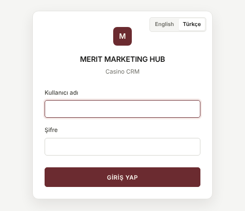
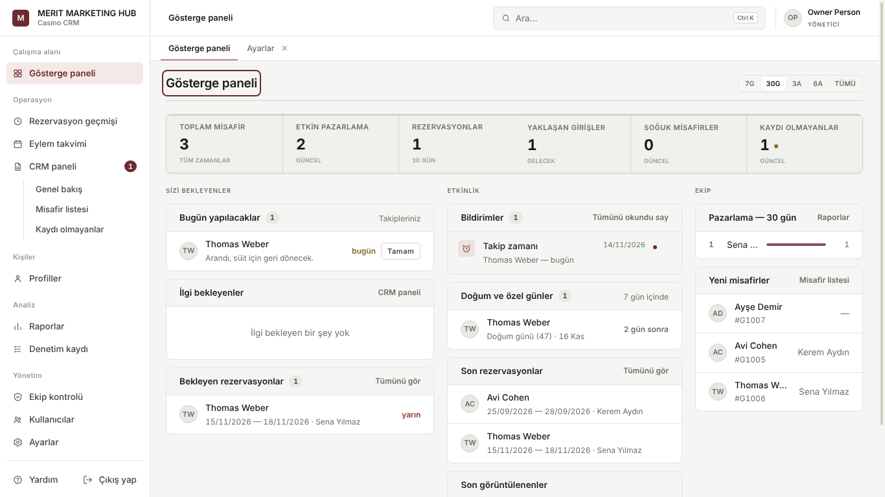
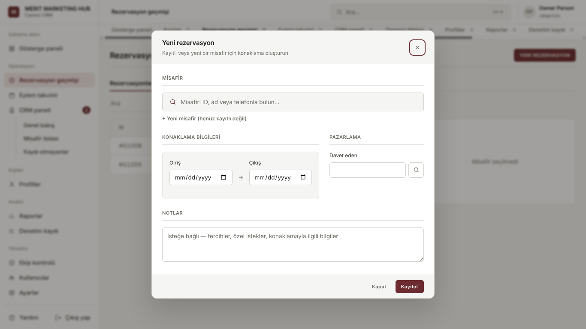
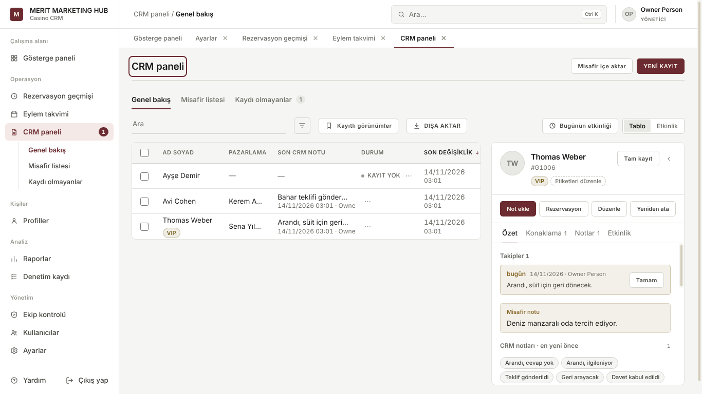
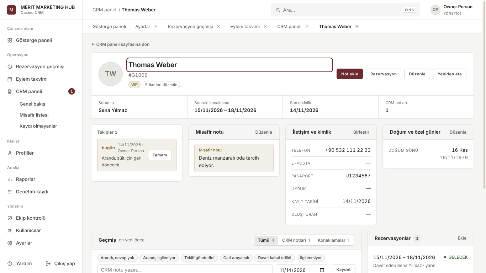
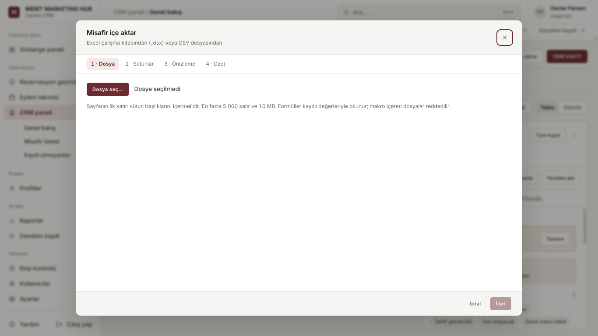
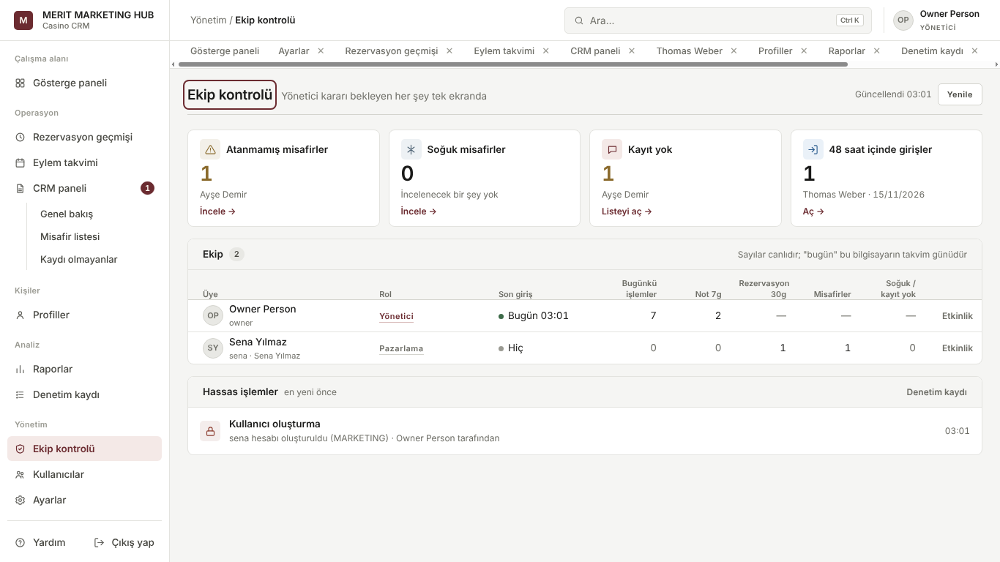
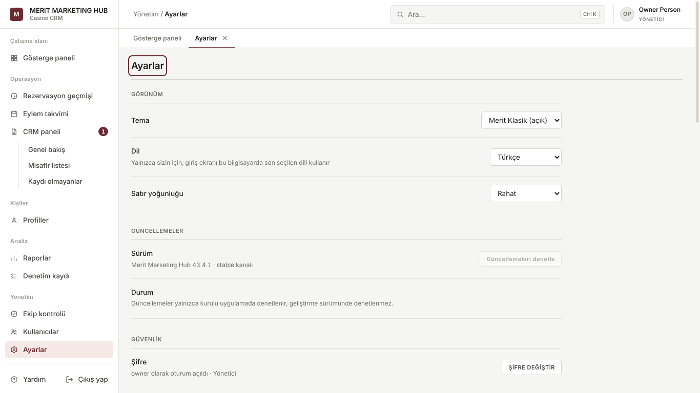

# Merit Marketing Hub — Kullanım kılavuzu

Bu kılavuz Merit Marketing Hub'ı her gün kullanan ekip için yazıldı: pazarlama
personeli, müdürler ve yöneticiler. Teknik bilgi gerektirmez. Uygulamanın içinde
de okunabilir: sol menünün altındaki **Yardım** düğmesi bu kılavuzu seçili dilde
açar.

> Ekranlarda gördüğünüz düğme adları bu kılavuzda **kalın** yazılmıştır. Arayüz
> İngilizce ise aynı düğmenin İngilizce adını görürsünüz; dili
> **Ayarlar › Görünüm › Dil** bölümünden değiştirebilirsiniz.

## İçindekiler

- [Kurulum ve ilk giriş](#kurulum-ve-ilk-giriş)
- [Eski sürümden geçiş](#eski-sürümden-geçiş)
- [Otomatik güncellemeler](#otomatik-güncellemeler)
- [Ekranın düzeni](#ekranın-düzeni)
- [Günlük çalışma akışı](#günlük-çalışma-akışı)
- [Gösterge paneli](#gösterge-paneli)
- [Rezervasyon geçmişi](#rezervasyon-geçmişi)
- [Eylem takvimi](#eylem-takvimi)
- [CRM paneli](#crm-paneli)
- [Misafir paneli ve tam kayıt](#misafir-paneli-ve-tam-kayıt)
- [Notlar, şablonlar ve hatırlatmalar](#notlar-şablonlar-ve-hatırlatmalar)
- [Etiketler, doğum günleri ve özel günler](#etiketler-doğum-günleri-ve-özel-günler)
- [Mükerrer misafirler ve birleştirme](#mükerrer-misafirler-ve-birleştirme)
- [Kayıtlı görünümler, arama ve kısayollar](#kayıtlı-görünümler-arama-ve-kısayollar)
- [Excel'den içe aktarma](#excelden-içe-aktarma)
- [Dışa aktarma, raporlar ve aylık PDF](#dışa-aktarma-raporlar-ve-aylık-pdf)
- [Toplu işlemler](#toplu-işlemler)
- [Bugünün etkinliği ve Ekip kontrolü](#bugünün-etkinliği-ve-ekip-kontrolü)
- [Denetim kaydı](#denetim-kaydı)
- [Bildirimler ve yönetici uyarıları](#bildirimler-ve-yönetici-uyarıları)
- [Profiller, kullanıcılar ve roller](#profiller-kullanıcılar-ve-roller)
- [Ayarlar](#ayarlar)
- [Sorun giderme ve sık sorulan sorular](#sorun-giderme-ve-sık-sorulan-sorular)

---

## Kurulum ve ilk giriş

### Kurulum

1. Size verilen **MeritMarketingHub-Setup.exe** dosyasına çift tıklayın.
2. Kurulum kendi kendine tamamlanır; soru sormaz ve yönetici (Administrator)
   yetkisi istemez. Bitince uygulama açılır ve masaüstüne, Başlat menüsüne
   **Merit Marketing Hub** kısayolu eklenir.
3. Uygulama internet olmadan da çalışır. İnternet yalnızca otomatik
   güncellemeler için kullanılır.

Verileriniz (misafirler, rezervasyonlar, notlar, fotoğraflar, yedekler)
programdan ayrı bir klasörde durur:

```
C:\Users\<kullanıcı adınız>\AppData\Roaming\Merit Marketing Hub\
```

Kısaca `%APPDATA%\Merit Marketing Hub` olarak da yazılır. Program güncellenince
veya yeniden kurulunca bu klasör **silinmez**.

### İlk açılış: yönetici hesabını oluşturma

Program boş başlar: hazır kullanıcı, hazır şifre veya örnek misafir yoktur. İlk
açılışta **Hoş geldiniz — Yönetici hesabını oluşturun** kartı görünür:

1. Kartın sağ üstündeki **English / Türkçe** düğmesiyle dili seçin.
2. **Ad Soyad**, **Kullanıcı adı**, **Şifre** ve **Şifreyi onaylayın**
   alanlarını doldurun.
3. **HESAP OLUŞTUR** düğmesine basın. Hesap oluşturulur ve oturumunuz açılır.

> Bu şifreyi unutmayın. Programda “şifremi unuttum” yoktur; bu bilinçli bir
> güvenlik kararıdır. Başka bir yönetici şifrenizi **Kullanıcılar** ekranından
> yenileyebilir. Tek yönetici sizseniz teknik destek ekibine başvurun.

### Giriş



**Kullanıcı adı** ve **Şifre** yazıp **GİRİŞ YAP** düğmesine basın (veya Enter).
Giriş ekranı bu bilgisayarda en son seçilen dili kullanır; kartın sağ üstünden
değiştirebilirsiniz.

- Aynı kullanıcı adıyla **5 kez** yanlış şifre girilirse hesap **5 dakika**
  kilitlenir ve yöneticilere uyarı gider.
- Uygulama **8 saat** hiç kullanılmazsa oturum kendiliğinden kapanır; ekranda
  misafir bilgisi açık kalmaz.
- Çıkmak için sol menünün altındaki **Çıkış yap** düğmesini veya **F8** tuşunu
  kullanın.

### İlk kurulumdan sonra yapılacaklar (yönetici)

1. **Profiller** ekranında her pazarlama personeli için bir **pazarlama
   profili** oluşturun.
2. **Kullanıcılar** ekranında her kişiye bir kullanıcı hesabı açın ve onu
   profiline bağlayın.
3. İsterseniz misafir listenizi Excel'den içe aktarın
   ([Excel'den içe aktarma](#excelden-içe-aktarma)).

---

## Eski sürümden geçiş

### Aynı bilgisayarda yeni sürüme geçmek

1. Eski sürümde yönetici olarak oturum açın, **Ayarlar › Veritabanı** bölümünde
   **YEDEKLE** düğmesine basın. “Yedek oluşturuldu” mesajını bekleyin.
2. Uygulamayı kapatın.
3. Güvenlik için `%APPDATA%\Merit Marketing Hub` klasörünün tamamını bir USB
   belleğe veya ağ klasörüne kopyalayın. (Windows Gezgini'nin adres çubuğuna
   `%APPDATA%` yazıp Enter'a basarak klasöre ulaşabilirsiniz.)
4. Yeni **MeritMarketingHub-Setup.exe** dosyasını çalıştırın. Kurulum eski
   programın yerine geçer; veri klasörünüze dokunmaz.
5. Uygulama açılınca her zamanki kullanıcı adınızla giriş yapın. Gerekirse
   veritabanı yapısı otomatik güncellenir; bundan önce de otomatik bir yedek
   alınır.

### Yeni bir bilgisayara taşımak

1. Eski bilgisayarda yukarıdaki 1–3. adımları yapın (yedek alın ve
   `%APPDATA%\Merit Marketing Hub` klasörünü kopyalayın).
2. Yeni bilgisayara **MeritMarketingHub-Setup.exe** ile kurun, ama **henüz
   hesap oluşturmayın**; uygulamayı kapatın.
3. Kopyaladığınız `Merit Marketing Hub` klasörünü yeni bilgisayarda
   `%APPDATA%` içine yapıştırın (varsa üzerine yazın).
4. Uygulamayı açın ve eski kullanıcı adınızla giriş yapın.

Alternatif yol: yeni bilgisayarda bir yönetici hesabı oluşturun, eski
bilgisayardaki `.mmhbackup` yedek dosyasını
`%APPDATA%\Merit Marketing Hub\backups\` klasörüne kopyalayın ve
**Ayarlar › Veritabanı › Geri yükle** listesinden o yedeği seçin. Geri
yüklemeden sonra eski hesaplarınız geçerli olur.

---

## Otomatik güncellemeler

Kurulu Windows uygulaması yeni sürümü kendisi denetler; kimsenin programı
kaldırıp yeniden kurması gerekmez.

- Uygulama açıldıktan yaklaşık **1 dakika** sonra ve açık kaldığı sürece **4
  saatte bir** yeni sürüm olup olmadığına bakar.
- İnternet yoksa hiçbir şey olmaz; uyarı da çıkmaz. Program normal çalışmaya
  devam eder.
- Yeni sürüm arka planda indirilir. İndirme biter bitmez otomatik bir **yedek**
  alınır.
- **Ayarlar › Güncellemeler** bölümünde sürüm numarası, durum ve son denetim
  zamanı görünür. **Güncellemeleri denetle** düğmesiyle beklemeden
  denetleyebilirsiniz.
- Güncelleme hazır olduğunda yöneticiler **Yeniden başlat ve güncelle**
  düğmesini görür. Basınca önce bir güvenlik yedeği daha alınır; yedek
  alınamazsa güncelleme **kurulmaz** ve nedeni yazılır. Bu sırada bilgisayardaki
  herkesin oturumu kapanır, program yeni sürümle yeniden açılır.
- İndirilen bir güncelleme, uygulama bir sonraki kapanıp açılışta da devreye
  girebilir. Verileriniz bundan etkilenmez; indirme anında zaten yedek
  alınmıştır.

---

## Ekranın düzeni



- **Sol menü**: tüm ekranlar burada gruplanmıştır — *Çalışma alanı* (Gösterge
  paneli), *Operasyon* (Rezervasyon geçmişi, Eylem takvimi, CRM paneli ve alt
  görünümleri), *Kişiler* (Profiller), *Analiz* (Raporlar, Denetim kaydı),
  *Yönetim* (Ekip kontrolü, Kullanıcılar, Ayarlar). En altta **Yardım** ve
  **Çıkış yap** bulunur. Rolünüzün açamadığı ekranlar menüde görünmez.
- **Üst çubuk**: solda bulunduğunuz yer (ör. *CRM paneli / Genel bakış*),
  ortada **Ara…** kutusu (**Ctrl K**), sağda adınız ve rolünüz.
- **Sekmeler**: açtığınız her ekran üst çubuğun altında bir sekme olarak kalır;
  aralarında geçiş yaptığınızda filtreleriniz ve seçiminiz korunur. Sekmeyi
  **✕** ile kapatın. Gösterge paneli kapatılamaz. **F10** tüm sekmeleri kapatıp
  Gösterge paneline döner (hiçbir veri silinmez).
- Tarihler her yerde **gg/aa/yyyy** biçimindedir.
- Ekranın sağ altında kısa bilgi mesajları (ör. “Not eklendi”) görünür ve
  kendiliğinden kaybolur.

---

## Günlük çalışma akışı

Tipik bir gün şöyle ilerler:

1. **Giriş yapın** ve **Gösterge paneline** bakın: *Bugün yapılacaklar*
   (hatırlatmalarınız), *Bildirimler*, *Bekleyen rezervasyonlar* ve
   *Doğum ve özel günler*.
2. Bugün aranacak misafirleri tek tek açın; her görüşmeden sonra **Not ekle**
   ile kısa bir CRM notu yazın. Tekrar aranacaksa nota **Hatırlatma tarihi**
   koyun.
3. Gelen rezervasyonları **YENİ REZERVASYON** ile girin; davet eden kişiyi
   doğru seçin.
4. Gün içinde birini bulmak için **Ctrl K** ile her yerde arayın.
5. Gün sonunda **CRM paneli › Bugünün etkinliği** ile yaptıklarınızı kontrol
   edin. Müdür ve yöneticiler ekibin gününü **Ekip kontrolü** ekranında görür.

---

## Gösterge paneli

Sağ üstteki **7G / 30G / 3A / 6A / TÜMÜ** düğmeleri dönemi seçer. Dönem;
*Rezervasyonlar* kartını ve *Pazarlama* sıralamasını etkiler.

**Temel göstergeler** (kartlara tıklayınca ilgili liste açılır):

| Kart | Anlamı |
|---|---|
| Toplam misafir | Kayıtlı misafir sayısı |
| Etkin pazarlama | Etkin pazarlama profili sayısı (yalnızca yönetici ve müdür) |
| Rezervasyonlar | Seçili dönemdeki rezervasyonlar |
| Yaklaşan girişler | Henüz giriş yapmamış gelecek rezervasyonlar |
| Soğuk misafirler | 90 günden uzun süredir konaklaması, gelecek rezervasyonu veya notu olmayan misafirler |
| Kaydı olmayanlar | Hiç rezervasyonu ve CRM notu olmayan kayıtlı misafirler |

**Sizi bekleyenler** sütunu:

- **Bugün yapılacaklar** — bugüne veya geçmişe kurulmuş takip hatırlatmalarınız.
  “bugün” veya “X gün gecikmiş” yazar. **Tamam** hatırlatmayı kapatır.
- **İlgi bekleyenler** (pazarlama kullanıcılarında **Aranması gerekenler**) —
  soğumaya başlayan misafirler. Satıra tıklayınca misafir açılır.
- **Bekleyen rezervasyonlar** — en yakın girişten başlayarak; “bugün”, “yarın”,
  “X gün sonra” yazar. **Tümünü gör** Rezervasyon geçmişini gelecek
  rezervasyonlarla açar.

**Etkinlik** sütunu:

- **Bildirimler** — size ait uyarılar. Misafirle ilgili bir bildirime
  tıklamak misafiri açar, **✕** tek bildirimi siler, **Tümünü okundu say**
  listeyi temizler.
- **Doğum ve özel günler** — önümüzdeki 7 gün içindeki doğum günleri ve özel
  günler.
- **Son rezervasyonlar** ve **Son görüntülenenler** — en son açtığınız misafirler.

**Ekip** sütunu (yalnızca yönetici ve müdür): dönemdeki rezervasyon sayısına
göre pazarlama sıralaması ve son eklenen **Yeni misafirler**.

---

## Rezervasyon geçmişi

Tüm konaklamaların listesi. Pazarlama kullanıcıları yalnızca kendi davet
ettikleri rezervasyonları görür.

- **Rezervasyonlar / İptal edilenler / Silinenler** sekmeleri. *Silinenler*
  yalnızca yönetici ve müdüre görünür.
- **Ara** kutusu misafir adı ve ID ile arar.
- **Filtre** (huni simgesi): *Durum* (Gelecek, Konaklıyor, Tamamlandı),
  *Davet eden*, *Giriş tarihi aralığı*. **Temizle** filtreleri kaldırır.
- **Kayıtlı görünümler** ve **DIŞA AKTAR** — bkz. ilgili bölümler.
- Sütun başlıklarına (AD SOYAD, GİRİŞ, ÇIKIŞ) tıklayarak sıralayın.
- Bir satıra **tıklamak** misafiri sağdaki panelde açar; **çift tıklamak**
  rezervasyonu düzenler. Satırın sonundaki kalem simgesi düzenler, çarpı simgesi
  iptal eder.

**Rezervasyon durumları**: GELECEK (giriş tarihi gelmedi), KONAKLIYOR (bugün
otelde), TAMAMLANDI (çıkış tarihi geçti), İPTAL, SİLİNDİ.

### Yeni rezervasyon



1. **YENİ REZERVASYON** düğmesine basın.
2. **Misafiri ID, ad veya telefonla bulun…** alanına tıklayın ve misafiri seçin.
   Misafir henüz kayıtlı değilse **+ Yeni misafir (henüz kayıtlı değil)**
   bağlantısıyla bir ID ve ad yazın.
3. **Giriş** ve **Çıkış** tarihlerini seçin.
4. **Davet eden** alanına pazarlama profilini yazın veya büyüteçle arayın.
   Pazarlama kullanıcılarında bu alan kilitlidir: oluşturdukları rezervasyon
   her zaman kendilerine yazılır.
5. İsterseniz **Rezervasyon notu** ekleyin ve **Kaydet**'e basın.

Uyarılar:

- **Misafirin koruma süresi dolmadı** — misafir başka bir pazarlamacıya aittir
  ve son konaklamasından veya atamasından bu yana bir yıl geçmemiştir; kayıt
  yapılamaz.
- **Çakışan rezervasyon** — misafirin bu tarihlerde başka bir rezervasyonu
  vardır. **Yine de kaydet** ile devam edebilirsiniz.

### İptal ve silme

- Rezervasyonu düzenlerken **Rezervasyonu iptal et**: bir neden seçin (Misafir
  isteği, Mükerrer, Tarihler değişti, Operasyonel, Diğer). İptal edilen
  rezervasyon silinmez; *İptal edilenler* sekmesinde kalır.
- Çöp kutusu simgesi (**yalnızca yönetici**): rezervasyonu kalıcı olarak siler.
  Neden yazmak zorunludur. Kayıt raporlardan ve sayımlardan çıkar, *Silinenler*
  sekmesinde kim sildi, ne zaman ve neden bilgisiyle saklanır.

---

## Eylem takvimi

Aylık takvim. Her günde üç sayı görünür: **Gelişler**, **Konaklayanlar** ve
**Ayrılışlar**.

- Okla önceki / sonraki aya geçin; **BUGÜN** bu aya döner. Takvim Ocak 2026'dan
  önceye gitmez.
- Bir güne tıklayınca o günün gelişleri, konaklayanları ve ayrılışları listelenir;
  bir misafire tıklayınca misafir açılır.

---

## CRM paneli



Misafir kitabınızın merkezi. Üç görünümü vardır (sol menüde de alt başlık
olarak görünür):

### Genel bakış

- Tablo: ID, AD SOYAD, PAZARLAMA (sorumlu), SON CRM NOTU, DURUM, SON DEĞİŞİKLİK.
- **Filtre**: TÜMÜ / SOĞUK / KAYIT YOK, *Pazarlama* (sorumlu) ve *Etiket*.
  Etkin filtreler tablonun üstünde etiket olarak görünür; **×** ile tek tek,
  **Tümünü temizle** ile hepsi kaldırılır.
- Satıra tıklayınca misafir sağdaki **misafir panelinde** açılır.
- Yönetici ve müdür, satır sonundaki **⋯** menüsünden **ATA** ve **DÜZENLE**
  komutlarını kullanabilir.
- **Tablo / Etkinlik** düğmesi tabloyu etkinlik akışıyla değiştirir (bkz.
  [Bugünün etkinliği](#bugünün-etkinliği-ve-ekip-kontrolü)).
- Üstteki **YENİ KAYIT**: bir misafir seçip sorumlu atamak ve/veya CRM notu
  eklemek için.
- **Misafir içe aktar**: Excel'den misafir ekleme.

### Misafir listesi

Tüm kayıtlı misafirler. **YENİ MİSAFİR** ile misafir eklenir. Filtreler: Durum,
Oluşturan, Sorumlu, Rezervasyonlar (var/yok), CRM etkinliği (var/yok), Etiket,
Oluşturulma tarihi aralığı.

**Yeni misafir** penceresi: Fotoğraf (tıklayıp seçin, sonra kırpın), Ad Soyad,
Misafir ID (benzersiz olmalı), Telefon, Pasaport no, Doğum tarihi. Pazarlama
kullanıcılarının oluşturduğu misafir otomatik olarak kendilerine atanır. Misafiri
düzenlerken çöp kutusu simgesi (**Misafiri sil**, rolünüz izin veriyorsa)
misafiri arşivler: etkin listelerden çıkar, rezervasyonları ve CRM geçmişi
korunur.

### Kaydı olmayanlar

Hiç rezervasyonu ve CRM notu olmayan kayıtlı misafirler (yalnızca yönetici ve
müdür). Bu misafirlerle ilk teması kurmak için kullanılır. Sayı, sol menüde ve
sekmede rozet olarak görünür. **DIŞA AKTAR** listeyi dosyaya verir.

### Misafir durumları

| Rozet | Anlamı |
|---|---|
| KAYIT YOK | Kayıtlı ama hiç rezervasyonu ve CRM notu yok |
| SOĞUK | Son konaklama, gelecek rezervasyon veya son not 90 günden eski |
| (rozet yok) | Etkin misafir |

---

## Misafir paneli ve tam kayıt

### Misafir paneli

Bir misafire tıkladığınızda sağda açılan panel:

- Üstte ad, ID, uyruk, durum ve etiketler. **Tam kayıt** misafirin tam sayfasını
  açar; **‹** paneli daraltır.
- Hızlı işlemler: **Not ekle**, **Rezervasyon**, **Düzenle**, **Yeniden ata**
  (yeniden atama yalnızca yönetici ve müdür).
- Sekmeler:
  - **Özet** — açık takipler (**Tamam** ile kapatılır), misafir notu, not yazma
    kutusu ve hızlı şablonlar, son 3 CRM notu (**… notun tümünü göster**),
    sonraki konaklama, iletişim bilgileri, doğum günü ve özel günler.
  - **Konaklama** — tüm konaklamalar, iptal edilenler dahil.
  - **Notlar** — tüm CRM notları, en yeni önce.
  - **Etkinlik** — misafirle ilgili her şey tarih sırasıyla.

### Tam kayıt



**Tam kayıt** misafiri ayrı bir sekmede açar:

- Üstte sorumlu, sonraki konaklama, son etkinlik ve CRM notu sayısı.
- Kartlar: Takipler, **Misafir notu**, **İletişim ve kimlik**, **Doğum ve özel
  günler**, **Rezervasyonlar** (**Ekle**) ve **Atama** geçmişi.
- **Geçmiş**: tüm notlar, konaklamalar ve atamalar; **Tümü / CRM notları /
  Konaklamalar** ile filtrelenir. Buradaki not kutusunda not tarihi de
  seçilebilir.
- **← … sayfasına dön** geldiğiniz ekrana döner.

---

## Notlar, şablonlar ve hatırlatmalar

- **Not ekle** veya panelin not kutusu ile CRM notu yazın ve **Kaydet**'e basın.
- **Hızlı şablonlar** (ör. *Arandı, cevap yok*, *Teklif gönderildi*) not
  kutusunun üstündedir; tıklayınca metin kutuya yazılır, ikinci şablon yeni
  satıra eklenir. Şablon listesi **Ayarlar › CRM not şablonları** bölümünden
  değiştirilir.
- **Hatırlatma tarihi**: nota bir tarih verirseniz o gün misafir **Bugün
  yapılacaklar** listesine girer ve size “Takip zamanı” bildirimi gelir.
- Bir notu düzeltmek için notun yanındaki **Düzenle** bağlantısını kullanın;
  hatırlatma tarihi de buradan değiştirilir veya silinir.
- Takip tamamlanınca **Tamam** düğmesine basın.

---

## Etiketler, doğum günleri ve özel günler

### Etiketler

- Misafir panelinde **+ Etiket ekle** / **Etiketleri düzenle** (veya **T**
  tuşu) etiket penceresini açar. Var olan etiketleri seçin ya da **Yeni etiket**
  alanına ad yazıp renk seçerek **Etiket ekle** ile oluşturun, sonra **Kaydet**.
- Etiketler tablolarda ad yanında görünür ve filtrede kullanılabilir.
- **Ayarlar › Misafir etiketleri** bölümünde etiket yeniden adlandırılır, rengi
  değiştirilir veya silinir (silinen etiket tüm misafirlerden kalkar).

### Doğum günleri ve özel günler

- Doğum tarihi misafir düzenleme penceresinde veya panelde **Doğum günü veya
  özel gün ekle** bağlantısıyla girilir.
- Özel günler (yıldönümü, isim günü…) her yıl tekrarlar: **+ Tarih ekle**, ad,
  ay ve gün seçin.
- Bu günler Gösterge panelinde bir hafta önceden görünür; günü gelince bildirim
  gönderilir.

---

## Mükerrer misafirler ve birleştirme

- Yeni misafir kaydederken aynı **telefon** veya **pasaport** numarasına sahip
  bir misafir varsa **Olası mükerrer misafir** uyarısı çıkar. **Mevcut kaydı aç**
  ile var olanı açın veya emin olduğunuzda **Yine de oluştur / Yine de kaydet**
  deyin. Misafir başka bir pazarlamacının portföyündeyse yalnızca var olduğu
  söylenir, kim olduğu gösterilmez.
- **Birleştirme** (varsayılan olarak yalnızca yönetici): tam kayıtta
  **İletişim ve kimlik** kartındaki **Birleştir** bağlantısı. Mükerrer misafiri
  bulun, kartları karşılaştırın ve **Misafirleri birleştir**'e basın. Notlar,
  rezervasyonlar, takipler, etiketler ve özel günler tutulan misafire taşınır;
  yalnızca boş alanlar mükerrer kayıttan doldurulur; mükerrer kayıt arşivlenir.
  İşlem denetim kaydına yazılır.

---

## Kayıtlı görünümler, arama ve kısayollar

### Kayıtlı görünümler

Genel bakış, Misafir listesi ve Rezervasyon geçmişi ekranlarında **Kayıtlı
görünümler** düğmesi bulunur. Arama ve filtrelerinizi ayarlayın, menüdeki
**Bu görünüme ad verin** alanına bir ad yazıp **Kaydet**'e basın. Daha sonra
görünümün adına tıklamak aynı arama ve filtreleri geri getirir; **✕** siler.
Görünümler kişiseldir.

### Her yerde arama (Ctrl K)

Üst çubuktaki **Ara…** kutusu veya **Ctrl K**:

- Boşken son görüntülenen misafirleri ve hızlı komutları (ekranlara git, yeni
  rezervasyon, yeni misafir…) gösterir.
- En az iki harf yazınca misafirler, CRM notları, rezervasyonlar ve profiller
  aranır. Kelimenin bir kısmı yeterlidir, büyük/küçük harf fark etmez.
- Oklarla gezinin, **Enter** ile açın, **Esc** ile kapatın. Bir grupta çok sonuç
  varsa **… sonucun tümünü göster** satırını kullanın.

### Klavye kısayolları

Bir alana yazı yazarken kısayollar çalışmaz. **?** tuşu bu listeyi gösterir.

| Tuş | İşlev |
|---|---|
| Ctrl K | Her yerde ara |
| / veya Ctrl F | Sayfanın arama kutusuna git |
| J / K | Listede aşağı / yukarı |
| Enter | Seçili satırı aç |
| E | Seçili satırı düzenle |
| N | Bu sayfada yeni kayıt |
| Esc | Paneli veya pencereyi kapat |
| ? | Kısayol listesi |
| F10 | Tüm sekmeleri kapat, Gösterge paneline dön |
| F8 | Çıkış yap |

Misafir paneli veya tam kayıt açıkken: **N** yeni CRM notu, **R** yeni
rezervasyon, **E** misafiri düzenle, **T** etiketler.

---

## Excel'den içe aktarma



**CRM paneli › Misafir içe aktar**. Dört adımdır:

1. **Dosya** — **Dosya seç…** ile bir `.xlsx` veya `.csv` dosyası seçin.
   Sayfanın ilk satırı sütun başlıkları olmalıdır. En fazla 5.000 satır ve
   10 MB. Formüller kayıtlı değerleriyle okunur; makro içeren dosyalar
   reddedilir. Birden çok sayfa varsa **Sayfa** listesinden seçin. Daha önce
   kaydettiğiniz bir eşleştirme varsa **Kayıtlı eşleştirme › Uygula**.
2. **Sütunlar** — her alan için dosyadaki sütunu seçin: Ad soyad *veya* Ad ve
   Soyad, Misafir ID, Telefon, E-posta, Pasaport no, Uyruk, Misafir notu, Oyun
   gücü (misafir notuna eklenir), Sorumlu (pazarlamacı adı). Alttaki tablo
   dosyanın ilk satırlarını gösterir. **Mükerrer kayıtlar** için seçin:
   *Zaten kayıtlı olan misafirleri atla* veya *Boş alanlarını dosyadan doldur*.
   Aynı düzende dosyalar için **Bu eşleştirmeyi kaydet**.
3. **Önizleme** — her satırın sonucu: **Yeni**, **Mükerrer** (nedeniyle
   birlikte), **Geçersiz** (eksik ad vb.). Üstte toplamlar ve “X oluşturulacak,
   Y atlanacak” özeti görünür; **Tümü / Yeni / Mükerrer / Geçersiz** ile
   filtreleyin.
4. **Özet** — **X misafiri içe aktar** düğmesine basıp onaylayın. İşlem tek
   adımda yazılır ve denetim kaydına işlenir. Özet ekranı oluşturulan,
   güncellenen ve atlanan satırları listeler.

Pazarlama kullanıcılarının içe aktardığı misafirler kendilerine atanır; Sorumlu
sütunu yok sayılır.

---

## Dışa aktarma, raporlar ve aylık PDF

### Dışa aktarma

Listelerdeki **DIŞA AKTAR** düğmesi, ekranda gördüğünüz listeyi aynı arama,
filtre ve sıralamayla dosyaya verir:

- **Biçim**: Excel çalışma kitabı (.xlsx) veya CSV (.csv).
- **Sütunlar**: istemediğiniz sütunların işaretini kaldırın (**Tümü / Hiçbiri**).
- **Tüm CRM notlarını ikinci bir sayfaya ekle** (yalnızca Excel, misafir
  listelerinde).
- **Dışa aktar**'a basınca Windows dosyanın nereye kaydedileceğini sorar.

### Raporlar

**Raporlar** ekranında rapor türünü seçin, filtreleri doldurun ve **RAPOR
OLUŞTUR**'a basın; sonuç tabloda görünür ve **DIŞA AKTAR** ile dosyaya verilir.

| Rapor | Filtreler |
|---|---|
| Rezervasyonlar | Durum, Davet eden, Giriş başlangıcı / bitişi |
| Misafir etkinliği | Durum, Sorumlu, Kayıt başlangıcı / bitişi |
| Pazarlama performansı | Dönem (yalnızca yönetici ve müdür) |
| Soğuk misafirler | Sorumlu |
| Kaydı olmayanlar | Kayıt başlangıcı / bitişi |

Pazarlama kullanıcıları raporlarda yalnızca kendi rakamlarını görür.

### Aylık rapor (PDF)

**Raporlar › Aylık rapor (PDF)**: ayı seçin ve **PDF oluştur**'a basın. Rapor;
ekip performansını, aydaki gelişleri ve konaklamaları, yeni misafirleri, soğuk
misafirleri ve en çok not alınan misafirleri yazdırılabilir A4 PDF olarak
içerir. Pazarlama kullanıcısının raporu yalnızca kendi misafirlerini kapsar.
PDF'in içeriği şu an İngilizcedir.

---

## Toplu işlemler

Genel bakış ve Misafir listesi tablolarının solundaki kutularla birden çok
misafir seçin (başlıktaki kutu sayfadakilerin tümünü seçer). Üstte bir çubuk
belirir:

- **Sorumluyu değiştir** — seçilenleri başka bir pazarlamacıya atar (yetki
  gerekir). İsterseniz bir neden yazın.
- **CRM notu ekle** — aynı notu tüm seçili misafirlere ekler.
- **Seçilenleri dışa aktar** — yalnızca seçili misafirleri dosyaya verir.
- **Seçimi temizle**.

Her misafir normal kurallardan geçer. Bazıları değiştirilemezse (ör. koruma
süresi), işlemden sonra bir pencere hangilerinin neden değişmediğini listeler.

---

## Bugünün etkinliği ve Ekip kontrolü

### Bugünün etkinliği

**CRM paneli › Genel bakış › Bugünün etkinliği** (veya **Tablo / Etkinlik**
düğmesindeki **Etkinlik**):

- Dönem: **Bugün / Dün / Son 7 gün / Son 30 gün**.
- Tür: **Tümü / CRM notları / Misafirler / Rezervasyonlar / Atamalar**.
- Üstte özet sayılar, altta gün gün işlem akışı. **Misafiri aç** ilgili misafire
  gider.
- Normalde yalnızca kendi işlemlerinizi görürsünüz. Yöneticiler ve
  “Herkesin etkinliğini görme” yetkisi verilenler **Ekip görünümü**nü ve
  soldaki **Ekip üyesine göre** listesini görür.

### Ekip kontrolü



Yönetici kararı bekleyen her şey tek ekranda (yöneticiler ve yetki verilenler):

- Uyarı kartları: **Atanmamış misafirler**, **Soğuk misafirler**, **Kayıt yok**,
  **48 saat içinde girişler**, varsa **Kilitli hesaplar**. Kartın altındaki
  bağlantı ilgili listeyi açar.
- **Ekip** tablosu: her üyenin rolü, son girişi, bugünkü işlemleri, 7 günlük
  notları, 30 günlük rezervasyonları, misafir sayısı ve soğuk / kayıt yok
  sayısı. **Etkinlik** o kişinin etkinlik akışını açar.
- **Hassas işlemler**: silmeler, atamalar, kilitlenmeler gibi son önemli
  işlemler. **Yenile** sayıları günceller.

---

## Denetim kaydı

Programda yapılan her önemli işlemin kaydı (yönetici ve müdür).

- Sütunlar: ZAMAN, KULLANICI, İŞLEM, KAYIT TÜRÜ, AYRINTI.
- Filtreler: **Kişi**, **İşlem**, **Başlangıç** ve **Bitiş** tarihi. Etkin
  filtreler etiket olarak görünür.
- **DIŞA AKTAR** filtrelenmiş kaydı dosyaya verir.

Denetim kaydı değiştirilemez ve silinemez.

---

## Bildirimler ve yönetici uyarıları

Bildirimler Gösterge panelindeki **Bildirimler** listesinde görünür:

- **Pazarlama**: size yeni misafir atandığında, misafiriniz soğuduğunda, 7 gün
  içinde veya 24 saat içinde giriş olduğunda, takip zamanı geldiğinde, doğum
  günü veya özel gün geldiğinde.
- **Müdür**: ekibin yaptığı işlemler (rezervasyon, misafir, not, profil) —
  **Ayarlar › Müdür etkinlik akışı** ile kapatılabilir.
- **Yönetici uyarıları** (“Yönetici uyarısı” etiketiyle): rezervasyon silindi,
  misafir silindi, misafirler birleştirildi, hesap kilitlendi, veri dışa
  aktarıldı, rol değişti. Kimin alacağı **Ayarlar › Yetkiler** bölümündeki
  “Yönetici uyarılarını alma” ile belirlenir.

Durumla ilgili bildirimler (soğuk misafir, yaklaşan giriş) durum geçince
kendiliğinden kaybolur. Kendi yaptığınız işlem size bildirim olarak gelmez.

---

## Profiller, kullanıcılar ve roller

### Profiller

**Profiller** ekranında her pazarlama personelinin kartı vardır: son 30 gündeki
rezervasyonları, misafir sayısı, son görülme ve 8 haftalık küçük bir grafik.

- **YENİ PROFİL**: ad soyad, fotoğraf, uyruk, pasaport no, telefon.
- Karta **çift tıklayınca** profil ayrıntısı açılır: **Genel bakış**, **Davet
  ettiği rezervasyonlar** (dönem seçilebilir), **Sorumlu olduğu misafirler**,
  **Misafir listesi**; her biri **Dışa aktar** ile dosyaya verilebilir.
  **DÜZENLE** profili düzenler.
- Şirketten ayrılan kişi için düzenleme penceresinde **Artık şirkette
  çalışmıyor** seçeneğini işaretleyin; geçmişi korunur.

### Kullanıcılar ve roller

**Kullanıcılar** (yalnızca yönetici): KULLANICI ADI, AD, ROL, DURUM, SON GİRİŞ.
Satıra çift tıklayınca düzenlenir; **YENİ KULLANICI** hesap açar.

| Rol | Ne yapabilir |
|---|---|
| Pazarlama | Yalnızca kendi misafirleri ve rezervasyonları; not, rezervasyon, misafir ekleme |
| Müdür | Tüm kayıtlar, atama, raporlar, denetim kaydı; rol değiştiremez |
| Yönetici | Tam erişim: kullanıcılar, yedek, geri yükleme, yetkiler, rezervasyon silme |

- Pazarlama hesabı bir pazarlama profiline **bağlanmalıdır**.
- Şifreyi yenilemek için kullanıcıyı açıp yeni şifre yazın; boş bırakılırsa
  mevcut şifre korunur.
- **Hesap etkin** işaretini kaldırmak veya penceredeki çöp kutusu simgesi
  (**Sil**) hesabı devre dışı bırakır; geçmiş korunur. En az bir etkin yönetici kalmalıdır.
- Her kullanıcı kendi şifresini **Ayarlar › Güvenlik › ŞİFRE DEĞİŞTİR** ile
  değiştirir.

---

## Ayarlar



- **Görünüm** (herkes, kişisel): **Tema** (Merit Klasik, Lacivert Kurumsal,
  Arduvaz Sade, Grafit Koyu), **Dil** (English / Türkçe) ve **Satır
  yoğunluğu**. Değişiklik hemen uygulanır ve yalnızca sizin hesabınız için
  saklanır. Giriş ekranı bu bilgisayarda en son seçilen dili kullanır.
- **Güncellemeler**: sürüm, durum, **Güncellemeleri denetle** ve (yönetici
  için) **Yeniden başlat ve güncelle**.
- **Güvenlik**: **ŞİFRE DEĞİŞTİR**.
- **CRM not şablonları** (yönetici ve müdür): her satıra bir şablon; **Şablonları
  kaydet** veya **Varsayılanlara dön**.
- **Misafir etiketleri** (yönetici ve müdür): ad, renk, silme.
- **Yetkiler** (yönetici): Müdür ve Pazarlama rolleri için açılıp kapatılabilen
  yetkiler — misafir silme, sorumlu değiştirme, mükerrer birleştirme, CRM notu
  silme, profil işlemleri, denetim kaydı, veri dışa aktarma, silinen
  rezervasyonları görme, ortak ayarlar, Ekip kontrolü, herkesin etkinliği,
  yönetici uyarıları. Değişiklik hemen kaydedilir.
- **Veritabanı** (yönetici):
  - **Otomatik yedekleme** açık/kapalı, **Sıklık** (Her açılışta, Günlük,
    Haftalık) ve **Saklanacak yedek sayısı** (5, 10, 20, 50). Elle alınan
    yedekler hiçbir zaman otomatik silinmez.
  - **Müdür etkinlik akışı** açık/kapalı.
  - **YEDEKLE** hemen bir yedek alır; **VERİ KLASÖRÜ** veri klasörünü Windows
    Gezgini'nde açar.
  - **Geri yükle** listesinden bir yedeği seçip **Geri yükle**: onaydan sonra
    önce mevcut verinin güvenlik kopyası alınır, sonra yedek geri yüklenir.

---

## Sorun giderme ve sık sorulan sorular

**Şifremi unuttum.** Başka bir yönetici **Kullanıcılar** ekranından yeni şifre
verebilir. Tek yönetici sizseniz teknik destek ekibine başvurun.

**“Çok fazla başarısız deneme” yazıyor.** 5 yanlış denemeden sonra hesap 5
dakika kilitlenir. Bekleyip yeniden deneyin.

**Oturumum kendiliğinden kapandı.** 8 saat işlem yapılmazsa veya yönetici
hesabınızı devre dışı bıraktıysa ya da rolünüzü değiştirdiyse oturum kapanır.
Yeniden giriş yapın.

**Bir misafiri göremiyorum.** Pazarlama kullanıcıları yalnızca kendilerine
atanmış misafirleri görür. “Bu misafir artık size atanmış değil” yazıyorsa
misafir başka birine atanmıştır; müdürünüze danışın.

**“Misafirin koruma süresi dolmadı” uyarısı.** Misafir başka bir pazarlamacıya
aittir ve son konaklamasından veya atamasından bu yana bir yıl geçmemiştir.
Yeniden atama müdür veya yönetici kararıdır.

**İçe aktarma dosyamı kabul etmiyor.** Dosyanın `.xlsx` veya `.csv` olduğundan,
10 MB ve 5.000 satırdan küçük olduğundan, ilk satırın başlık olduğundan ve
makro içermediğinden emin olun. Makrolu dosyayı Excel'de “Excel Çalışma Kitabı
(.xlsx)” olarak yeniden kaydedin.

**Güncelleme gelmiyor.** Bilgisayarın internete bağlı olduğundan emin olun ve
**Ayarlar › Güncellemeler › Güncellemeleri denetle**'ye basın. Durum satırı
nedeni yazar.

**Verilerimi nasıl korurum?** Otomatik yedekleme açık kalsın. Ayda bir
`%APPDATA%\Merit Marketing Hub\backups` klasöründeki en yeni dosyayı bir USB
belleğe kopyalayın.

**Arayüz dili yanlış.** **Ayarlar › Görünüm › Dil**'den seçin. Giriş ekranında
kartın sağ üstündeki **English / Türkçe** düğmesini kullanın.

**Tarih kutuları ay/gün sırasında görünüyor.** Tarih seçicinin görünümü
Windows'un bölge ayarını izler; listelerde ve raporlarda tarihler her zaman
gg/aa/yyyy yazılır.

**Bir hata mesajı İngilizce çıktı.** Sık görülen mesajlar Türkçeye çevrilir;
nadir mesajlar İngilizce görünebilir. Mesajı aynen teknik destek ekibine
iletin.
