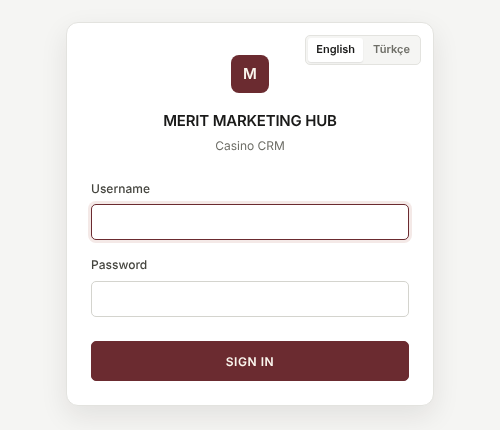
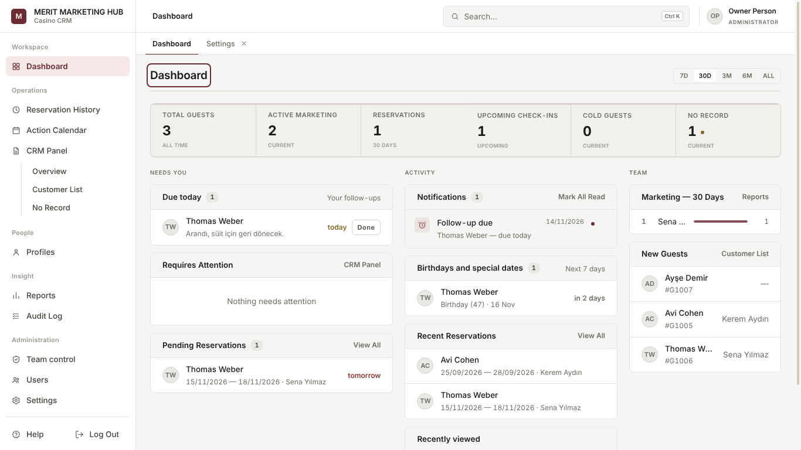
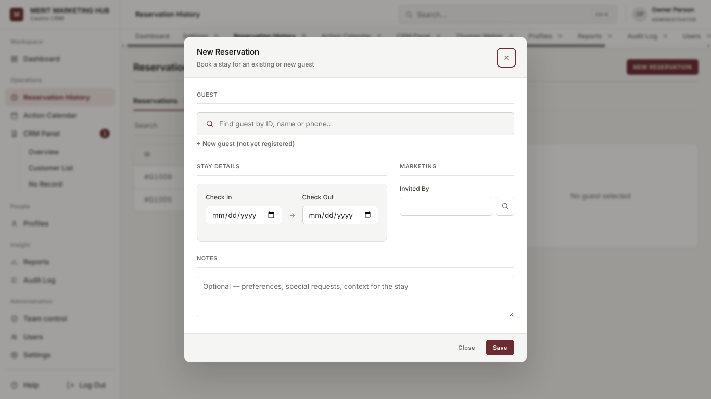
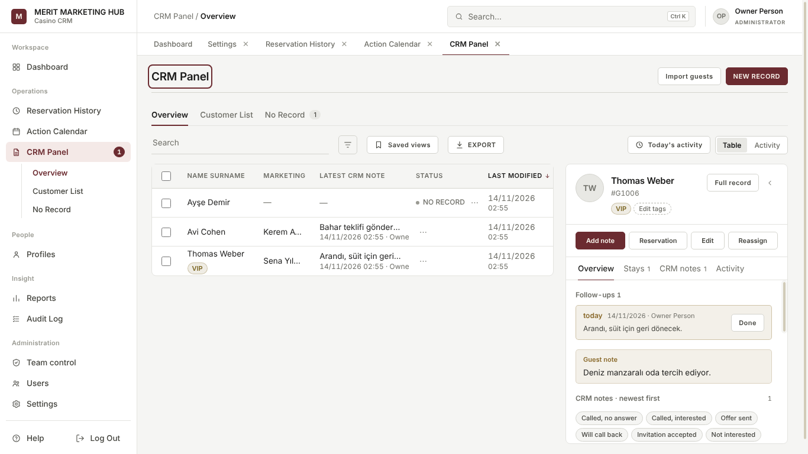
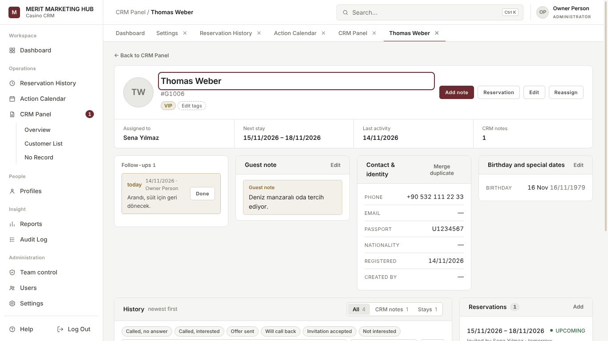
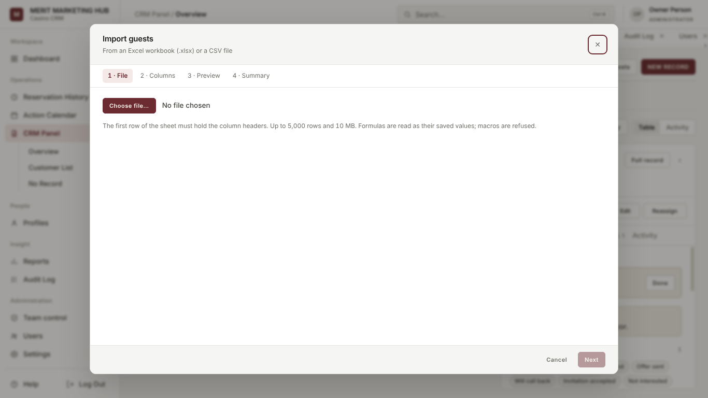
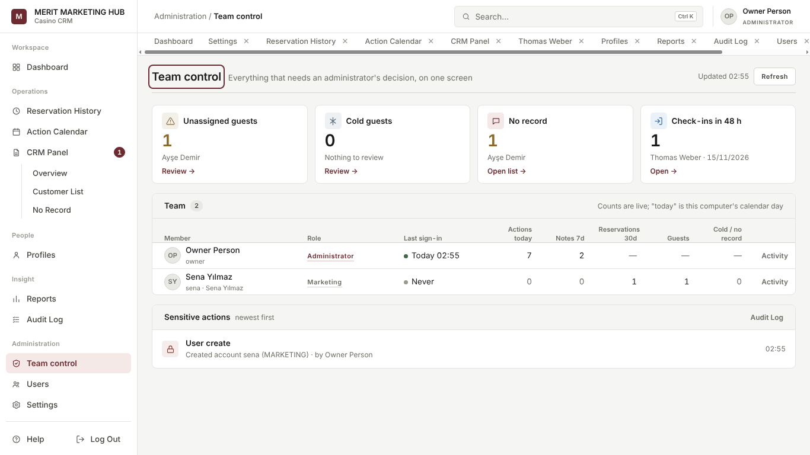
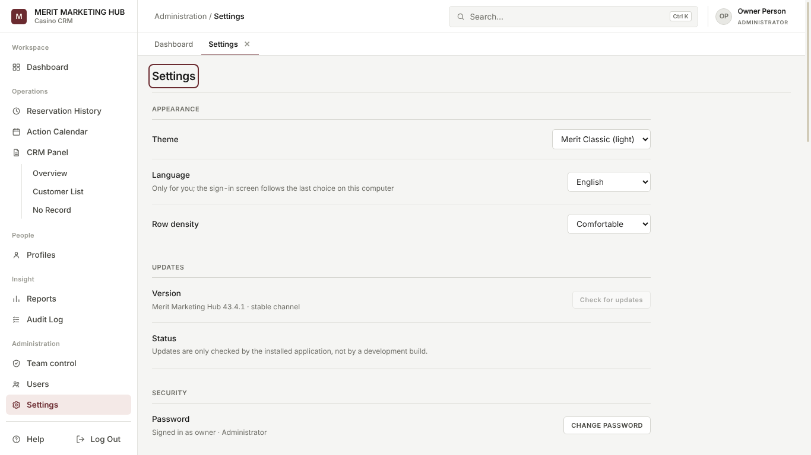

# Merit Marketing Hub — User manual

This manual is for the people who use Merit Marketing Hub every day: marketing
staff, managers and administrators. No technical knowledge is needed. It can
also be read inside the application: the **Help** button at the bottom of the
left menu opens it in the selected language.

> Button names are written in **bold**, exactly as they appear on screen. If the
> interface is in Turkish you see the Turkish name of the same button; change
> the language in **Settings › Appearance › Language**.

## Contents

- [Installing and first sign-in](#installing-and-first-sign-in)
- [Moving from the old version](#moving-from-the-old-version)
- [Automatic updates](#automatic-updates)
- [The screen layout](#the-screen-layout)
- [Daily workflow](#daily-workflow)
- [Dashboard](#dashboard)
- [Reservation History](#reservation-history)
- [Action Calendar](#action-calendar)
- [CRM Panel](#crm-panel)
- [Guest panel and full record](#guest-panel-and-full-record)
- [Notes, templates and reminders](#notes-templates-and-reminders)
- [Tags, birthdays and special dates](#tags-birthdays-and-special-dates)
- [Duplicate guests and merging](#duplicate-guests-and-merging)
- [Saved views, search and shortcuts](#saved-views-search-and-shortcuts)
- [Importing from Excel](#importing-from-excel)
- [Export, reports and the monthly PDF](#export-reports-and-the-monthly-pdf)
- [Bulk actions](#bulk-actions)
- [Today's activity and Team control](#todays-activity-and-team-control)
- [Audit Log](#audit-log)
- [Notifications and administrator alerts](#notifications-and-administrator-alerts)
- [Profiles, users and roles](#profiles-users-and-roles)
- [Settings](#settings)
- [Troubleshooting and FAQ](#troubleshooting-and-faq)

---

## Installing and first sign-in

### Installing

1. Double-click the **MeritMarketingHub-Setup.exe** file you were given.
2. Setup finishes on its own: it asks no questions and needs no administrator
   rights. When it is done the application opens, and a **Merit Marketing
   Hub** shortcut is added to the desktop and the Start menu.
3. The application works without the Internet. The Internet is only used for
   automatic updates.

Your data (guests, reservations, notes, photos, backups) is kept in a folder
separate from the program:

```
C:\Users\<your user name>\AppData\Roaming\Merit Marketing Hub\
```

It is also written as `%APPDATA%\Merit Marketing Hub`. Updating or reinstalling
the program **never deletes** this folder.

### First start: creating the administrator account

The program starts empty: there is no built-in user, no default password and no
sample guest. On the first start the **Welcome — Create the administrator
account** card appears:

1. Choose the language with the **English / Türkçe** switch in the card's
   top-right corner.
2. Fill in **Full Name**, **Username**, **Password** and **Confirm Password**.
3. Press **CREATE ACCOUNT**. The account is created and you are signed in.

> Do not lose this password. There is no "forgot password" — that is a
> deliberate security decision. Another administrator can set a new password for
> you on the **Users** screen. If you are the only administrator, contact your
> technical support.

### Signing in



Type your **Username** and **Password** and press **SIGN IN** (or Enter). The
sign-in screen uses the language last chosen on this computer; change it with
the switch in the card's top-right corner.

- After **5** wrong passwords for the same username the account is locked for
  **5 minutes**, and administrators are alerted.
- If the application is not used for **8 hours** you are signed out
  automatically, so no guest record is left on an unattended screen.
- To sign out use **Log Out** at the bottom of the left menu, or **F8**.

### After the first start (administrator)

1. On **Profiles**, create a **marketing profile** for every member of the
   marketing team.
2. On **Users**, create a user account for each person and link it to their
   profile.
3. Optionally import your guest list from Excel
   ([Importing from Excel](#importing-from-excel)).

---

## Moving from the old version

### Upgrading on the same computer

1. In the old version, sign in as an administrator and press **BACKUP** in
   **Settings › Database**. Wait for "Backup created".
2. Close the application.
3. To be safe, copy the whole `%APPDATA%\Merit Marketing Hub` folder to a USB
   stick or a network folder. (Type `%APPDATA%` in the Windows Explorer address
   bar and press Enter to get there.)
4. Run the new **MeritMarketingHub-Setup.exe**. It replaces the old program and
   does not touch your data folder.
5. When the application opens, sign in with your usual username. If the
   database structure needs updating this happens automatically, and an
   automatic backup is taken first.

### Moving to a new computer

1. On the old computer do steps 1–3 above (take a backup and copy the
   `%APPDATA%\Merit Marketing Hub` folder).
2. Install with **MeritMarketingHub-Setup.exe** on the new computer, but **do
   not create an account yet** — close the application.
3. Paste the copied `Merit Marketing Hub` folder into `%APPDATA%` on the new
   computer (overwrite if asked).
4. Open the application and sign in with your old username.

Another way: create an administrator account on the new computer, copy the
`.mmhbackup` file from the old computer into
`%APPDATA%\Merit Marketing Hub\backups\`, then choose that backup in the
**Settings › Database › Restore** list. After the restore your old accounts are
the ones that work.

---

## Automatic updates

The installed Windows application looks for new versions by itself; nobody has
to uninstall or reinstall it.

- About **1 minute** after it starts, and then **every 4 hours** while it stays
  open, it checks whether a newer version exists.
- With no Internet nothing happens and no message appears; the program carries
  on as normal.
- A new version is downloaded in the background. As soon as the download
  finishes an automatic **backup** is taken.
- **Settings › Updates** shows the version, the status and when it last checked.
  **Check for updates** checks immediately.
- When an update is ready, administrators see **Restart and update**. Pressing
  it takes another safety backup first; if that backup cannot be made the update
  is **not** installed and the reason is shown. Everyone on the computer is
  signed out and the program reopens on the new version.
- A downloaded update can also take effect the next time the application is
  closed and opened. Your data is not affected; a backup was already taken when
  it was downloaded.

---

## The screen layout



- **Left menu**: every screen, grouped — *Workspace* (Dashboard), *Operations*
  (Reservation History, Action Calendar, CRM Panel and its views), *People*
  (Profiles), *Insight* (Reports, Audit Log), *Administration* (Team control,
  Users, Settings). **Help** and **Log Out** are at the bottom. Screens your
  role cannot open are not shown.
- **Top bar**: where you are on the left (e.g. *CRM Panel / Overview*), the
  **Search…** box in the middle (**Ctrl K**), your name and role on the right.
- **Tabs**: every screen you open stays as a tab under the top bar; switching
  between them keeps your filters and selection. Close a tab with **✕**. The
  Dashboard cannot be closed. **F10** closes every tab and returns to the
  Dashboard (no data is deleted).
- Dates are always shown as **dd/mm/yyyy**.
- Short messages (e.g. "Note added") appear at the bottom right and disappear
  by themselves.

---

## Daily workflow

A typical day:

1. **Sign in** and look at the **Dashboard**: *Due today* (your reminders),
   *Notifications*, *Pending Reservations* and *Birthdays and special dates*.
2. Open the guests you need to call; after each call write a short CRM note
   with **Add note**. If you need to call again, give the note a **Remind me
   on** date.
3. Enter new bookings with **NEW RESERVATION**, choosing the right inviter.
4. To find anyone during the day, search everything with **Ctrl K**.
5. At the end of the day check your work in **CRM Panel › Today's activity**.
   Managers and administrators see the team's day on **Team control**.

---

## Dashboard

The **7D / 30D / 3M / 6M / ALL** buttons at the top right choose the period. The
period affects the *Reservations* card and the *Marketing* ranking.

**Key metrics** (click a card to open the matching list):

| Card | Meaning |
|---|---|
| Total Guests | Registered guests |
| Active Marketing | Active marketing profiles (administrators and managers only) |
| Reservations | Reservations in the chosen period |
| Upcoming Check-ins | Future reservations not yet checked in |
| Cold Guests | Guests with no stay, upcoming stay or note in more than 90 days |
| No Record | Registered guests with no reservation and no CRM note |

**Needs You** column:

- **Due today** — your follow-up reminders for today or earlier. It says
  "today" or "overdue Nd". **Done** closes a reminder.
- **Requires Attention** (**Needs A Call** for marketing users) — guests going
  cold. Click a row to open the guest.
- **Pending Reservations** — soonest arrival first, marked "today", "tomorrow"
  or "in N days". **View All** opens Reservation History on upcoming stays.

**Activity** column:

- **Notifications** — alerts for you. Clicking one about a guest opens the
  guest, **✕** removes one, **Mark All Read** clears the list.
- **Birthdays and special dates** — birthdays and special dates in the next 7
  days.
- **Recent Reservations** and **Recently viewed** — the guests you opened last.

**Team** column (administrators and managers only): marketing ranking by
reservations in the period, and the latest **New Guests**.

---

## Reservation History

Every stay. Marketing users only see the reservations they invited.

- **Reservations / Cancelled / Deleted** tabs. *Deleted* is visible to
  administrators and managers only.
- The **Search** box searches guest name and ID.
- **Filter** (funnel icon): *Status* (Upcoming, Checked in, Completed),
  *Invited By*, *Check-in Between*. **Clear** removes the filters.
- **Saved views** and **EXPORT** — see their sections.
- Click a column heading (NAME SURNAME, CHECK IN, CHECK OUT) to sort.
- **Click** a row to open the guest in the panel on the right; **double-click**
  to edit the reservation. The pencil at the end of a row edits, the cross
  cancels.

**Reservation statuses**: UPCOMING (not arrived yet), CHECKED IN (in the hotel
today), COMPLETED (check-out date has passed), CANCELLED, DELETED.

### New reservation



1. Press **NEW RESERVATION**.
2. Click **Find guest by ID, name or phone…** and choose the guest. If the guest
   is not registered yet, use **+ New guest (not yet registered)** and type an
   ID and a name.
3. Choose the **Check In** and **Check Out** dates.
4. Type the marketing profile in **Invited By**, or search with the magnifier.
   For marketing users this field is locked: their reservations are always
   attributed to them.
5. Optionally add a **Reservation Note** and press **Save**.

Warnings:

- **Guest protection period has not expired** — the guest belongs to another
  marketer and less than a year has passed since their last stay or assignment;
  the booking cannot be made.
- **Overlapping reservation** — the guest already has a booking on those dates.
  **Save anyway** continues.

### Cancelling and deleting

- While editing a reservation, **Cancel Reservation**: pick a reason (Guest
  request, Duplicate, Dates changed, Operational, Other). A cancelled
  reservation is not deleted; it stays in the *Cancelled* tab.
- The bin icon (**administrators only**) deletes the reservation permanently. A
  reason is required. The booking leaves every report and count, and is kept in
  the *Deleted* tab with who deleted it, when and why.

---

## Action Calendar

A month view. Each day shows three numbers: **Arrivals**, **In House** and
**Departures**.

- Use the arrows for the previous / next month; **TODAY** returns to this month.
  The calendar does not go back before January 2026.
- Click a day to list that day's arrivals, in-house guests and departures; click
  a guest to open them.

---

## CRM Panel



The centre of your guest book. It has three views (also listed under it in the
left menu):

### Overview

- Table: ID, NAME SURNAME, MARKETING (owner), LATEST CRM NOTE, STATUS, LAST
  MODIFIED.
- **Filter**: ALL / COLD / NO RECORD, *Marketing* (owner) and *Tag*. Active
  filters appear as chips above the table; remove one with **×** or all with
  **Clear all**.
- Click a row to open the guest in the **guest panel** on the right.
- Administrators and managers have **ASSIGN** and **EDIT** in the **⋯** menu at
  the end of a row.
- **Table / Activity** swaps the table for the activity feed (see
  [Today's activity](#todays-activity-and-team-control)).
- **NEW RECORD** at the top: pick a guest and assign an owner and/or add a CRM
  note.
- **Import guests**: add guests from Excel.

### Customer List

All registered guests. **NEW CUSTOMER** adds one. Filters: Status, Created By,
Assigned To, Reservations (has / none), CRM Activity (has / none), Tag, Created
Between.

The **New Customer** dialog: Photo (click to choose, then crop), Full Name,
Customer ID (must be unique), Phone, Passport No, Birth date. A guest created by
a marketing user is assigned to them automatically. When editing a guest, the
bin icon (**Delete guest**, if your role may) archives the guest: they leave the
active lists, but their reservations and CRM history are kept.

### No Record

Registered guests with no reservation and no CRM note (administrators and
managers only) — the people waiting for a first contact. The count shows as a
badge in the menu and on the tab. **EXPORT** writes the list to a file.

### Guest statuses

| Badge | Meaning |
|---|---|
| NO RECORD | Registered, but no reservation and no CRM note |
| COLD | Last stay, next stay or last note older than 90 days |
| (no badge) | An active guest |

---

## Guest panel and full record

### Guest panel

The panel that opens on the right when you click a guest:

- Name, ID, nationality, status and tags at the top. **Full record** opens the
  guest's own page; **‹** collapses the panel.
- Quick actions: **Add note**, **Reservation**, **Edit**, **Reassign**
  (reassigning is for administrators and managers).
- Tabs:
  - **Overview** — open follow-ups (close them with **Done**), the guest note,
    the note box with quick templates, the latest 3 CRM notes (**Show all N
    notes**), the next stay, contact details, birthday and special dates.
  - **Stays** — every stay, cancelled ones included.
  - **CRM notes** — every CRM note, newest first.
  - **Activity** — everything about the guest in date order.

### Full record



**Full record** opens the guest in its own tab:

- At the top: owner, next stay, last activity and number of CRM notes.
- Cards: follow-ups, **Guest note**, **Contact & identity**, **Birthday and
  special dates**, **Reservations** (**Add**) and **Assignment** history.
- **History**: every note, stay and assignment; filter with **All / CRM notes /
  Stays**. The note box here also lets you choose the note date.
- **← Back to …** returns to the screen you came from.

---

## Notes, templates and reminders

- Write a CRM note with **Add note** or the panel's note box, then **Save**.
- **Quick templates** (e.g. *Called, no answer*, *Offer sent*) sit above the
  note box; one click writes the text, a second template goes on a new line. The
  list is changed in **Settings › CRM note templates**.
- **Remind me on**: give a note a date and on that day the guest appears in
  **Due today** and you get a "Follow-up due" notification.
- To correct a note use the **Edit** link next to it; the reminder date is
  changed or removed there too.
- When the follow-up is done, press **Done**.

---

## Tags, birthdays and special dates

### Tags

- In the guest panel **+ Add tag** / **Edit tags** (or the **T** key) opens the
  tag dialog. Pick existing tags, or type a name in **New tag**, choose a colour
  and press **Add tag**; then **Save**.
- Tags appear next to the name in the tables and can be used as a filter.
- **Settings › Guest tags** renames, recolours or deletes a tag (a deleted tag is
  removed from every guest).

### Birthdays and special dates

- The birth date is entered in the guest's edit dialog, or with **Add birthday
  or special date** in the panel.
- Special dates (anniversary, name day…) repeat every year: **+ Add a date**,
  then a label, month and day.
- These dates appear on the Dashboard a week ahead, and a notification is sent
  on the day.

---

## Duplicate guests and merging

- When you save a guest with the same **phone** or **passport** number as an
  existing guest, a **Possible duplicate guest** warning appears. **Open
  existing** opens the one already there, or press **Create anyway / Save
  anyway** when you are sure. If the guest is in another marketer's book you are
  only told that it exists, not who it is.
- **Merging** (administrators by default): the **Merge duplicate** link on the
  **Contact & identity** card of the full record. Find the duplicate, compare
  the two cards and press **Merge guests**. Notes, reservations, follow-ups,
  tags and special dates move to the guest you keep; only empty fields are
  filled from the duplicate; the duplicate is archived. The merge is recorded in
  the audit log.

---

## Saved views, search and shortcuts

### Saved views

Overview, Customer List and Reservation History have a **Saved views** button.
Set up your search and filters, type a name in **Name this view** in the menu
and press **Save**. Clicking the name later brings back the same search and
filters; **✕** deletes it. Saved views are personal.

### Search everything (Ctrl K)

The **Search…** box in the top bar, or **Ctrl K**:

- Empty, it shows recently viewed guests and quick commands (go to a screen,
  new reservation, new customer…).
- Type at least two letters to search guests, CRM notes, reservations and
  profiles. Part of a word is enough, and capitals do not matter.
- Move with the arrows, open with **Enter**, close with **Esc**. When a group
  has many results use **Show all N**.

### Keyboard shortcuts

Shortcuts never fire while you are typing in a field. **?** shows this list.

| Key | Action |
|---|---|
| Ctrl K | Search everything |
| / or Ctrl F | Focus the page's search box |
| J / K | Move down / up the list |
| Enter | Open the selected row |
| E | Edit the selected row |
| N | New record on this page |
| Esc | Close panel or dialog |
| ? | The shortcut list |
| F10 | Close every tab and return to the Dashboard |
| F8 | Log out |

With a guest panel or full record open: **N** new CRM note, **R** new
reservation, **E** edit the guest, **T** tags.

---

## Importing from Excel



**CRM Panel › Import guests**. Four steps:

1. **File** — choose an `.xlsx` or `.csv` file with **Choose file…**. The first
   row of the sheet must hold the column headers. Up to 5,000 rows and 10 MB.
   Formulas are read as their saved values; files with macros are refused. If
   there are several sheets choose one in **Sheet**. If you saved a mapping
   earlier, use **Saved mapping › Apply**.
2. **Columns** — choose the file column for each field: Full name *or* Name and
   Surname, Guest ID, Phone, Email, Passport no, Nationality, Guest note, Gaming
   power (added to the guest note), Owner (marketing name). The table below
   shows the first rows of the file. For **Duplicates** choose *Skip guests
   already in the book* or *Fill their empty fields from the file*. For files
   with the same layout, **Save this mapping**.
3. **Preview** — the result for every row: **New**, **Duplicate** (with the
   reason), **Invalid** (missing name etc.). Totals and a "Will create X and skip
   Y" summary appear at the top; filter with **All / New / Duplicate /
   Invalid**.
4. **Summary** — press **Import N guests** and confirm. The import is written in
   one step and recorded in the audit log. The summary lists created, updated
   and skipped rows.

Guests imported by a marketing user are assigned to that user; the Owner column
is ignored.

---

## Export, reports and the monthly PDF

### Export

The **EXPORT** button on a list writes what is on screen to a file, with the
same search, filters and sort order:

- **Format**: Excel workbook (.xlsx) or CSV (.csv).
- **Columns**: untick the columns you do not want (**All / None**).
- **Add every CRM note on a second sheet** (Excel only, on guest lists).
- Press **Export** and Windows asks where to save the file.

### Reports

On **Reports** choose a report type, fill in the filters and press **GENERATE
REPORT**; the result appears as a table and **EXPORT** writes it to a file.

| Report | Filters |
|---|---|
| Reservations | Status, Invited By, Check-in From / To |
| Guest Activity | Status, Assigned To, Registered From / To |
| Marketing Performance | Period (administrators and managers only) |
| Cold Guests | Assigned To |
| No Record | Registered From / To |

Marketing users see only their own figures in reports.

### Monthly report (PDF)

**Reports › Monthly report (PDF)**: choose the month and press **Create PDF**.
The report has team performance, arrivals and stays in the month, new guests,
cold guests and the most discussed guests, as a printable A4 PDF. A marketing
user's report covers only their own guests. The PDF content is in English.

---

## Bulk actions

Tick several guests with the boxes on the left of the Overview and Customer List
tables (the box in the heading selects everyone on the page). A bar appears:

- **Reassign owner** — gives the selected guests to another marketer (needs the
  permission). Optionally give a reason.
- **Add CRM note** — adds the same note to every selected guest.
- **Export selected** — writes only the selected guests to a file.
- **Clear selection**.

Every guest goes through the normal rules. If some cannot be changed (e.g. the
protection period), a dialog afterwards lists which ones and why.

---

## Today's activity and Team control

### Today's activity

**CRM Panel › Overview › Today's activity** (or **Activity** on the **Table /
Activity** switch):

- Period: **Today / Yesterday / Last 7 days / Last 30 days**.
- Kind: **All / CRM notes / Guests / Reservations / Assignments**.
- Summary numbers at the top, the actions day by day below. **Open guest** goes
  to the guest.
- Normally you only see your own actions. Administrators, and people given the
  "See everyone's activity" permission, get the **Team view** and the **By team
  member** list on the left.

### Team control



Everything that needs an administrator's decision, on one screen
(administrators and people given the permission):

- Alert cards: **Unassigned guests**, **Cold guests**, **No record**,
  **Check-ins in 48 h** and, when there are any, **Locked accounts**. The link on
  each card opens the matching list.
- The **Team** table: each member's role, last sign-in, actions today, notes in
  7 days, reservations in 30 days, guests and cold / no-record count.
  **Activity** opens that person's activity feed.
- **Sensitive actions**: recent important actions such as deletions,
  assignments and lock-outs. **Refresh** updates the numbers.

---

## Audit Log

A record of every important action in the program (administrators and
managers).

- Columns: WHEN, USER, ACTION, ENTITY, DETAIL.
- Filters: **Person**, **Action**, **From** and **To** dates. Active filters show
  as chips.
- **EXPORT** writes the filtered log to a file.

The audit log cannot be edited or deleted.

---

## Notifications and administrator alerts

Notifications appear in the **Notifications** list on the Dashboard:

- **Marketing**: when a new guest is assigned to you, when your guest goes cold,
  when there is a check-in within 7 days or within 24 hours, when a follow-up is
  due, and on a birthday or special date.
- **Managers**: what the team does (reservations, guests, notes, profiles) —
  can be switched off with **Settings › Manager activity feed**.
- **Administrator alerts** (labelled "Administrator alert"): reservation
  deleted, guest deleted, guests merged, account locked, data exported, role
  changed. Who receives them is set with "Receive administrator alerts" in
  **Settings › Permissions**.

Notifications about a situation (cold guest, upcoming check-in) disappear by
themselves when the situation is over. You are never notified about your own
actions.

---

## Profiles, users and roles

### Profiles

**Profiles** shows a card for every member of the marketing team: reservations
in the last 30 days, guests, last seen and a small 8-week chart.

- **NEW PROFILE**: full name, photo, nationality, passport no, phone.
- **Double-click** a card for the profile details: **Overview**, **Reservations
  Invited** (with a period), **Assigned Guests**, **Customer List**; each can be
  written to a file with **Export**. **EDIT** edits the profile.
- When someone leaves the company tick **No longer with the company** in the
  edit dialog; their history is kept.

### Users and roles

**Users** (administrators only): USERNAME, NAME, ROLE, STATUS, LAST LOGIN.
Double-click a row to edit; **NEW USER** creates an account.

| Role | What it can do |
|---|---|
| Marketing | Only their own guests and reservations; add notes, reservations and guests |
| Manager | All records, assignment, reports, the audit log; cannot change roles |
| Administrator | Full access: users, backup, restore, permissions, deleting reservations |

- A marketing account **must** be linked to a marketing profile.
- To set a new password open the user and type it; leave it blank to keep the
  current one.
- Unticking **Account active**, or the bin icon (**Delete**) in the dialog,
  disables the account; its history is kept. At least one active administrator must remain.
- Everyone changes their own password with **Settings › Security › CHANGE
  PASSWORD**.

---

## Settings



- **Appearance** (everyone, personal): **Theme** (Merit Classic, Navy Corporate,
  Slate Compact, Graphite Dark), **Language** (English / Türkçe) and **Row
  density**. Changes apply at once and are saved for your account only. The
  sign-in screen uses the language last chosen on this computer.
- **Updates**: version, status, **Check for updates** and (for administrators)
  **Restart and update**.
- **Security**: **CHANGE PASSWORD**.
- **CRM note templates** (administrators and managers): one template per line;
  **Save templates** or **Restore defaults**.
- **Guest tags** (administrators and managers): name, colour, delete.
- **Permissions** (administrators): permissions that can be switched on or off
  for the Manager and Marketing roles — delete guests, reassign guest ownership,
  merge duplicate guests, delete CRM notes, profile actions, the audit log,
  export data, view deleted reservations, change shared settings, Team control,
  everyone's activity, administrator alerts. Changes are saved at once.
- **Database** (administrators):
  - **Automatic backup** on/off, **Frequency** (Every startup, Daily, Weekly)
    and **Backups to keep** (5, 10, 20, 50). Backups you take yourself are
    never removed automatically.
  - **Manager activity feed** on/off.
  - **BACKUP** takes a backup now; **DATA FOLDER** opens the data folder in
    Windows Explorer.
  - Choose a backup in the **Restore** list and press **Restore**: after you
    confirm, a safety copy of the current data is taken first, then the backup
    is restored.

---

## Troubleshooting and FAQ

**I forgot my password.** Another administrator can set a new one on **Users**.
If you are the only administrator, contact your technical support.

**It says "Too many failed attempts".** After 5 wrong tries the account is
locked for 5 minutes. Wait and try again.

**I was signed out by myself.** This happens after 8 hours without activity, or
when an administrator disables your account or changes your role. Sign in again.

**I cannot see a guest.** Marketing users only see guests assigned to them. "This
guest is no longer assigned to you" means the guest was given to someone else;
ask your manager.

**"Guest protection period has not expired".** The guest belongs to another
marketer and less than a year has passed since their last stay or assignment.
Reassigning is a manager's or administrator's decision.

**The import does not accept my file.** Check that it is `.xlsx` or `.csv`,
under 10 MB and 5,000 rows, that the first row is the headers, and that it has
no macros. Save a macro file in Excel as "Excel Workbook (.xlsx)".

**No update arrives.** Make sure the computer is online and press **Settings ›
Updates › Check for updates**. The status line says why.

**How do I keep my data safe?** Keep automatic backup on. Once a month copy the
newest file from `%APPDATA%\Merit Marketing Hub\backups` to a USB stick.

**The interface is in the wrong language.** Choose it in **Settings › Appearance
› Language**. On the sign-in screen use the **English / Türkçe** switch in the
card's corner.

**Date boxes show month/day order.** The date picker follows the Windows region
setting; lists and reports always show dates as dd/mm/yyyy.

**An error message appeared in English while the interface is Turkish.** The
common messages are translated; rare ones may still appear in English. Pass the
message on to technical support as it is.
